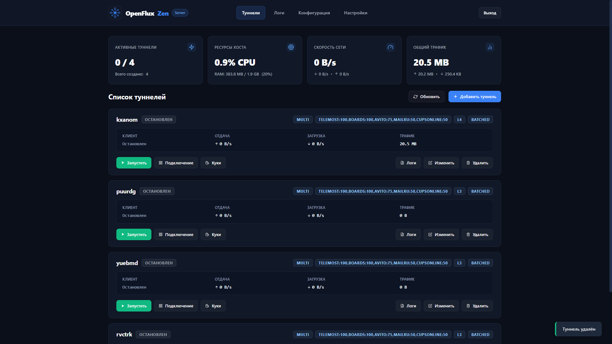
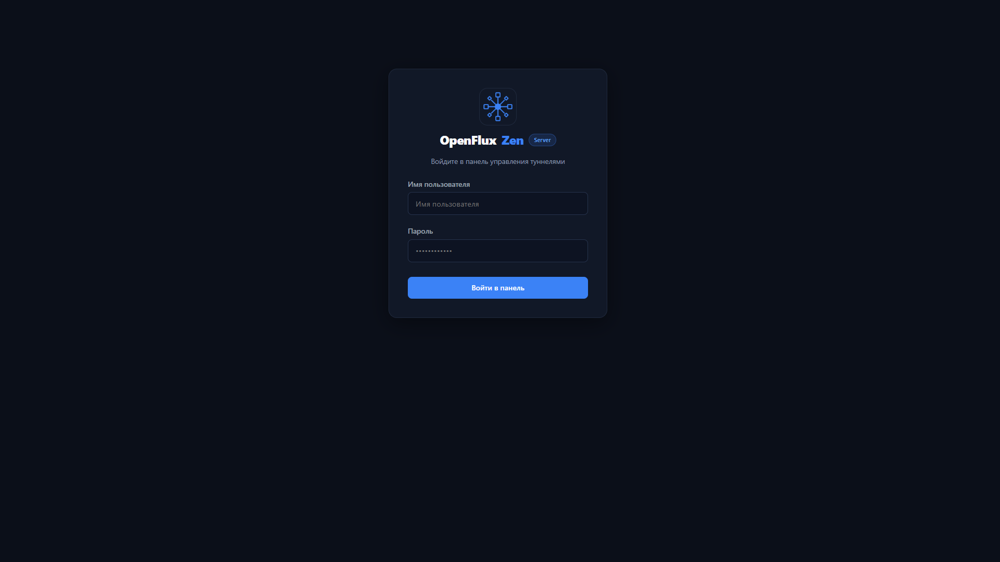
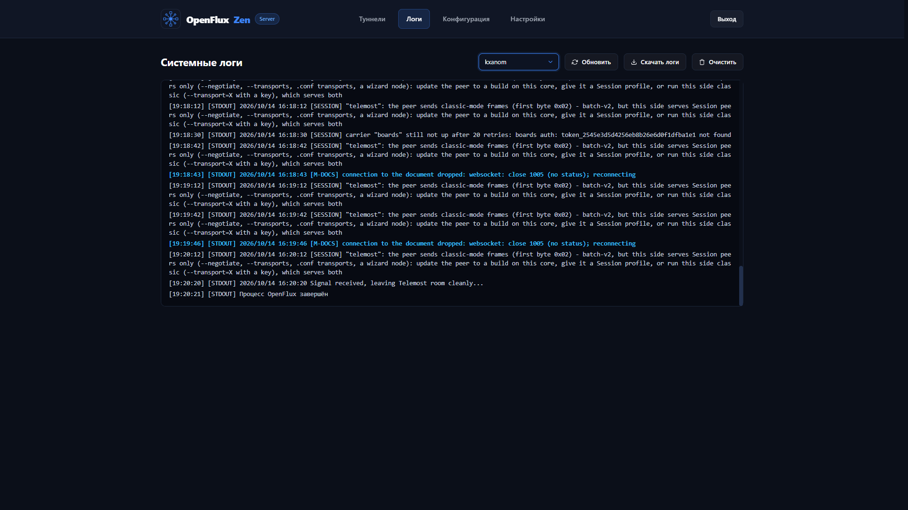
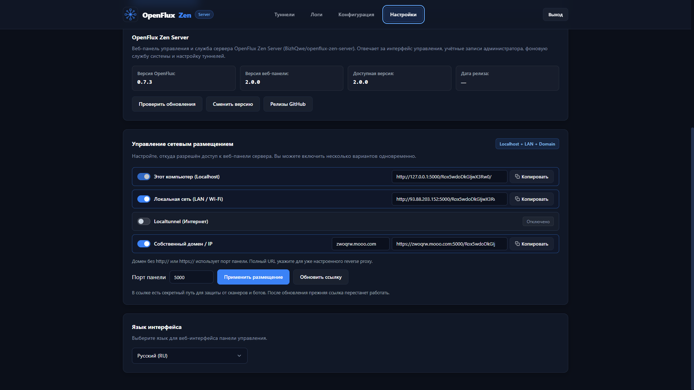
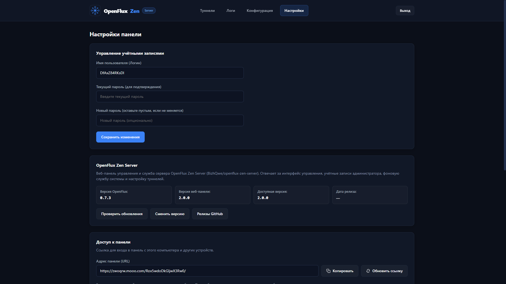
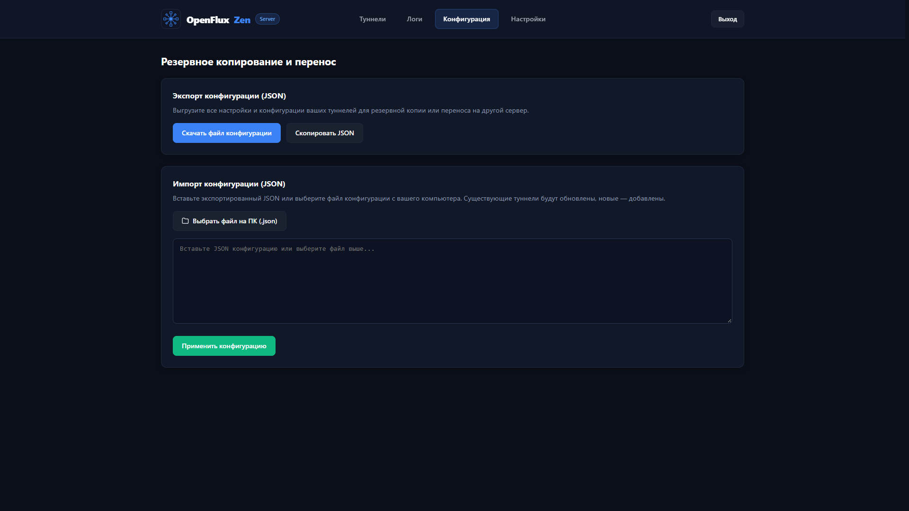

[Русский](README.md) | [English](README_EN.md)

<p align="center">
  
</p>

<h1 align="center">OpenFlux Zen Server</h1>

<p align="center">
  <strong>Автономный сервер и веб-панель для управления туннелями OpenFlux</strong>
</p>

<p align="center">
  
  
  <a href="LICENSE"></a>
  <a href="https://github.com/BizhQwe/openflux-zen-server/releases"></a>
</p>

## О проекте

**OpenFlux Zen Server** — это готовое серверное решение на базе ядра [OpenFlux](https://github.com/p1neappleXpress/OpenFlux), оснащённое интуитивной веб-панелью, системной службой и CLI-утилитой для администрирования. 

Сервер позволяет развернуть защищённую инфраструктуру L3/L4-туннелей за считаные минуты: настраивать серверные (exit) туннели прямо в браузере, отслеживать нагрузку и трафик в реальном времени, а клиентам мгновенно передавать конфигурации через ссылки или QR-коды.

Все компоненты (**Core**, **Web**, **CLI**, **Installer**) написаны на Go и скомпилированы в единые автономные бинарники:
- **Никаких сторонних баз данных** — данные и настройки надёжно хранятся локально.
- **Никакого внешнего веб-сервера** — статика интерфейса встроена прямо в бинарник панели.
- **Не требуется Docker** — всё работает нативно как системная служба (systemd в Linux или Windows Service).

## Возможности

Ядро обновлено до OpenFlux v0.13.0. Добавлены Bitrix24, Mixed/Striped-группы, параметры каналов/сетей и исходящий SOCKS5-прокси для L4. Аудит и перенос локальных патчей описаны в [отчёте миграции](docs/core-upgrade-v0.13.0.md).

- 🚀 **Управление туннелями**: создание, редактирование, запуск и остановка серверных L3/L4-туннелей OpenFlux, поддержка Multi-конфигураций и различных сетевых транспортов.
- 📊 **Мониторинг и метрики**: отображение скорости приёма/передачи в реальном времени, учёт трафика, загрузки CPU, RAM и диска сервера.
- 📜 **Живые логи**: встроенный просмотрщик логов ядра и системы с фильтрацией и автообновлением.
- 📱 **Мгновенное подключение клиентов**: автоматическая генерация совместимых конфигурационных ссылок и QR-кодов для клиентских приложений OpenFlux.
- 🌐 **4 сетевых режима**:
  - `domain` — подключение по публичному IP или через домен / Reverse Proxy (Nginx, Caddy).
  - `localtunnel` — встроенная публикация без белого IP и проброса портов (NAT traversal).
  - `lan` — доступ только внутри локальной сети или домашнего Wi-Fi.
  - `localhost` — доступ строго с локальной машины.
- 🔒 **Безопасность из коробки**: панель скрыта за уникальным секретным URL-путём (`/<secret_path>/`), пароли хранятся в виде криптографических хэшей с солью, поддерживаются HTTPS/TLS-сертификаты.
- 🛠 **Встроенный CLI (`openflux`)**: быстрая проверка статуса, просмотр реквизитов доступа, перезапуск службы и управление автозагрузкой из терминала.
- 🌍 **Двуязычный интерфейс**: полноценная поддержка русского и английского языков в панели, установщике и CLI.

## Скриншоты

<details>
<summary><strong>Нажмите, чтобы просмотреть скриншоты интерфейса</strong></summary>
<br>

| Список и статус туннелей | Вход в панель |
|:---:|:---:|
|  |  |

| Просмотр логов в реальном времени | Сетевые настройки и режимы доступа |
|:---:|:---:|
|  |  |

| Общие настройки сервера | Импорт и экспорт конфигурации |
|:---:|:---:|
|  |  |

</details>

## Установка

Поддерживаются 2 удобных способа установки:

### Вариант 1: Быстрая установка одной командой (рекомендуется)

Скрипт автоматически определит архитектуру процессора, загрузит подходящий установщик из последнего релиза GitHub, сверит контрольную сумму SHA-256 и запустит мастер установки.

#### Linux
В системе должен быть установлен `curl` (при необходимости: `sudo apt install -y curl`):
```bash
curl -sSL https://raw.githubusercontent.com/BizhQwe/openflux-zen-server/main/scripts/install.sh | sudo sh
```

#### Windows
Откройте **PowerShell от имени администратора** и выполните:
```powershell
irm https://raw.githubusercontent.com/BizhQwe/openflux-zen-server/main/scripts/install.ps1 | iex
```

### Вариант 2: Загрузка готового установщика (GitHub Releases)

Перейдите на страницу [GitHub Releases](https://github.com/BizhQwe/openflux-zen-server/releases) и скачайте файл установщика для своей системы:

| Платформа | Архитектуры | Файл установщика |
|---|---|---|
| **Linux** | `amd64`, `arm64`, `386`, `armv7` | `openflux-zen-server-installer-linux-<arch>` |
| **Windows** | `amd64`, `arm64`, `386` | `openflux-zen-server-installer-windows-<arch>.exe` |

Запустите скачанный файл:
```bash
# Linux (с правами root / sudo)
chmod +x openflux-zen-server-installer-linux-amd64
sudo ./openflux-zen-server-installer-linux-amd64

# Windows
.\openflux-zen-server-installer-windows-amd64.exe
```

### Параметры тихой установки и тонкой настройки

Установщик поддерживает флаги командной строки для автоматизации (unattended setup):

```bash
# Пример: тихая установка на порту 8080 с режимом domain и автозапуском
sudo ./openflux-zen-server-installer-linux-amd64 --silent --mode domain --domain "vpn.example.com" --port 8080 --lang ru --autostart on
```

| Параметр | По умолчанию | Описание |
|---|---|---|
| `--mode <mode>` | интерактивно (`domain`) | Сетевой режим: `domain`, `localtunnel`, `lan`, `localhost` |
| `--port <port>` | `5000` | Порт веб-панели (от 1 до 65535) |
| `--listen <host:port>` | зависит от режима | Точный адрес хоста и порт прослушивания |
| `--domain <url>` | пусто | Публичный домен или адрес обратного прокси |
| `--lang <ru\|en>` | `ru` / `en` | Язык интерфейса мастера и панели |
| `--autostart <on\|off>` | `on` | Автозапуск службы при старте ОС |
| `--silent` | `false` | Тихий режим (без интерактивных вопросов мастера) |
| `--dir <path>` | `/opt/openflux-zen-server` или `Program Files` | Каталог установки |
| `--no-service` | `false` | Установить бинарники без регистрации системной службы |
| `--reset-password` | `false` | Сгенерировать новый пароль при обновлении |
| `--verify` | `false` | Проверить целостность встроенного архива и выйти |

> [!NOTE]
> При первой установке автоматически генерируются уникальный логин администратора и надёжный пароль. Они выводятся в итоговой сводке вместе с адресом входа в панель. **Обязательно сохраните их!**

## Быстрый старт

После завершения установки:

1. **Откройте веб-панель**: в браузере перейдите по URL, показанному в сводке установщика:
   ```text
   http://<IP-сервера>:5000/<секретный_путь>/
   ```
2. **Войдите в систему**: введите уникальный логин и пароль, которые были сгенерированы установщиком при начальной настройке.
3. **Создайте туннель**:
   - Перейдите в раздел **Туннели** и нажмите **Добавить туннель**.
   - Настройте параметры туннеля (порт, сетевой транспорт, ключ шифрования) и сохраните.
   - Нажмите **Запустить**.
4. **Подключите клиентов**:
   - Нажмите на созданный туннель, чтобы открыть параметры подключения.
   - Скопируйте готовую ссылку подключения или отсканируйте **QR-код** в приложении-клиенте OpenFlux.

> [!TIP]
> Если вы забыли пароль, логин или потеряли ссылку на панель, выполните команду на сервере:
> ```bash
> openflux credentials
> ```
> *(в Linux: `sudo openflux credentials`)* — команда мгновенно отобразит сгенерированный логин, пароль и все доступные URL-адреса панели.

## Управление через CLI (`openflux`)

В состав сервера входит удобная консольная утилита `openflux`. В Windows она доступна сразу из любой командной строки, в Linux — в `/usr/local/bin/openflux` (или через sudo).

```bash
openflux <команда> [параметры]
```

### Основные команды

| Команда | Описание | Пример |
|---|---|---|
| `status` | Показать статус сервера, службы и сетевой адрес | `openflux status` |
| `credentials` | Показать реквизиты входа (логин, пароль, ссылки) | `sudo openflux credentials` |
| `start` | Запустить системную службу сервера | `sudo openflux start` |
| `stop` | Остановить системную службу сервера | `sudo openflux stop` |
| `restart` | Перезапустить системную службу сервера | `sudo openflux restart` |
| `autostart <enable\|disable\|status>` | Управление автозапуском при загрузке системы | `sudo openflux autostart enable` |
| `uninstall [-y]` | Полное удаление сервера, службы, туннелей и данных | `sudo openflux uninstall` |
| `help` | Показать встроенную справку | `openflux help` |

## Сетевые режимы и публикация

OpenFlux Zen Server поддерживает четыре сценария сетевого размещения:

1. **Публичный IP / Домен (`domain`)**:
   - Стандартный режим для VPS с внешним IP-адресом.
   - Позволяет настроить работу через доменное имя, поддомен или Reverse Proxy (Caddy, Nginx) с готовыми SSL-сертификатами.
2. **Localtunnel (`localtunnel`)**:
   - Идеально подходит, если у сервера **нет белого IP** (находится за CGNAT, мобильным интернетом или домашним роутером без возможности проброса портов).
   - Сервер автоматически подключается к защищённому облачному релею и выдаёт публичный URL для доступа к панели из любой точки мира.
3. **Локальная сеть (`lan`)**:
   - Панель доступна для всех устройств в вашей домашней или рабочей сети (по локальному IP-адресу сервера в сети, например `http://192.168.1.100:5000/...`).
4. **Только этот ПК (`localhost`)**:
   - Сервер привязывается к локальному адресу `127.0.0.1` и доступен исключительно с машины, на которой запущен.

## Структура проекта

```text
src/
  OpenFlux.Zen.Server.Core/       # Ядро OpenFlux (туннелирование, L3/L4, сетевые протоколы)
  OpenFlux.Zen.Server.Web/        # Веб-панель: HTTP API, аутентификация, хранилище и встроенный UI
  OpenFlux.Zen.Server.Cli/        # Консольная утилита управления установленной службой (openflux)
  OpenFlux.Zen.Server.Installer/  # Единый самораспаковывающийся установщик
scripts/                          # Скрипты сборки (build.sh / build.ps1) и установки
docs/screenshots/                 # Скриншоты веб-интерфейса
dist/                             # Скомпилированные исполняемые файлы и релизные пакеты
go.work                           # Go workspace проекта
```

Исходный код веб-интерфейса находится в каталоге `src/OpenFlux.Zen.Server.Web/internal/panel/web`. Все шаблоны, скрипты, стили и изображения упаковываются в исполняемый файл через `go:embed`.

## Сборка из исходников

Для сборки требуется **Go 1.26.9+** (версия указана в `go.work`).
Для `.sh` нужны POSIX shell и `sha256sum` (Linux / Git Bash); версии `.ps1` работают без Git Bash.

Клонируйте репозиторий:
```bash
git clone https://github.com/BizhQwe/openflux-zen-server.git
cd openflux-zen-server
```

### Сборка под текущую платформу

```bash
# Linux
sh scripts/build.sh linux-amd64

# Windows
powershell -ExecutionPolicy Bypass -File scripts\build.ps1 -Targets windows-amd64
```

### Сборка всех целевых платформ

```bash
# Без параметров собираются все семь платформ Windows и Linux в dist/
sh scripts/build.sh

# Или на Windows
powershell -ExecutionPolicy Bypass -File scripts\build.ps1
```

Готовые бинарники и самодостаточные файлы установщиков (`openflux-zen-server-installer-*`) вместе с SHA-256 хэшами будут сохранены в каталоге `dist/`.

Список платформ общий для всех скриптов: [scripts/targets.txt](scripts/targets.txt). Флаги `--all` / `-All` также поддерживаются; конкретную платформу можно выбрать, как в примерах выше.

### Подготовка релиза

Команда собирает все платформы, проверяет индивидуальные SHA-256 и создаёт общий `dist/SHA256SUMS.txt`:

```bash
sh scripts/package-release.sh
```

```powershell
.\scripts\package-release.ps1
```

Для уже собранных файлов используйте `sh scripts/package-release.sh --skip-build dist` или `.\scripts\package-release.ps1 -SkipBuild -ReleaseDir dist`. Другой каталог задаётся позиционным аргументом в `.sh` или через `-ReleaseDir` в `.ps1`; при обычном запуске в него копируется полный комплект установщиков. Эти скрипты готовят файлы локально, без публикации на GitHub.

## Лицензия и благодарности

- Проект распространяется под свободной лицензией **GNU General Public License v3.0**. Полный текст лицензии доступен в файле [LICENSE](LICENSE).
- Проект основан на разработках [OpenFlux](https://github.com/p1neappleXpress/OpenFlux).
- Используемые компоненты и сторонние библиотеки перечислены в файле [NOTICE](NOTICE) (включая WireGuard-go, gVisor, gopacket, Gorilla WebSocket, pion/webrtc и другие).
